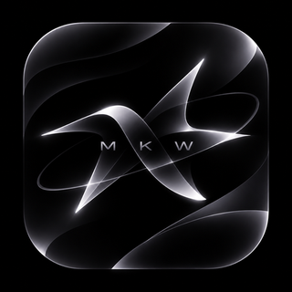
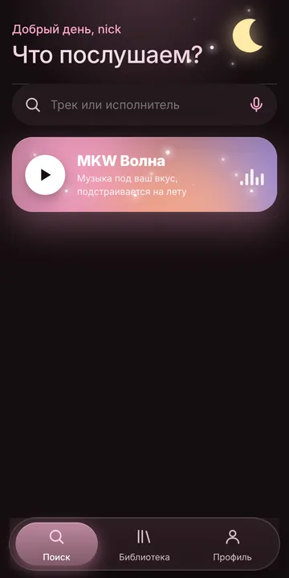
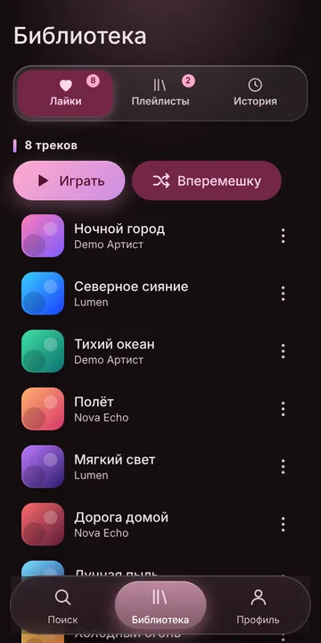
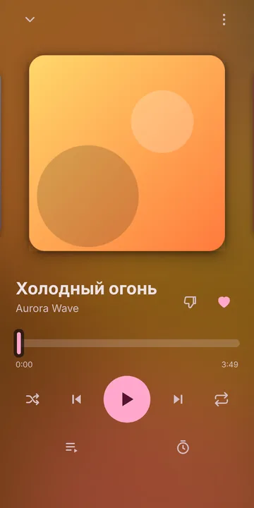
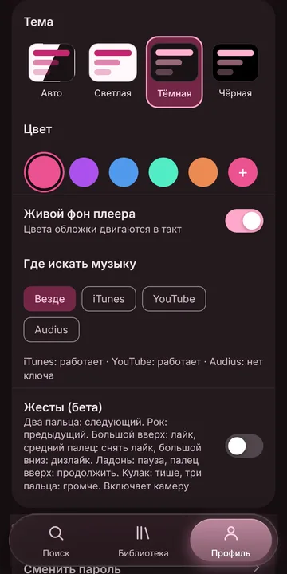

# MKW Music

**Бесплатный музыкальный плеер: бесконечная волна под ваш вкус и управление жестами**

 

---

## Что такое MKW Music

MKW Music — музыкальный веб-плеер для телефона и компьютера. Он открывается в браузере и устанавливается как обычное приложение. Все обновления и разработку делает **MiloKwel**.

## Возможности

| Возможность | Описание |
|---|---|
| MKW Волна | Бесконечный поток музыки под ваш вкус: учитывает лайки и историю, реагирует на пропуски и дослушивания, открывает новых исполнителей из любимых жанров, не ставит одного артиста подряд |
| Управление жестами | Девять жестов камерой: следующий и предыдущий трек, лайк и снять лайк, дизлайк, пауза и продолжить, тише и громче. Камера работает на вашем устройстве, изображение никуда не передаётся |
| Поиск | iTunes, YouTube, Audius и поиск по ссылке. Источник выбирается в Профиле |
| Шазам | Узнать песню с микрофона или из файла |
| Поделиться | Ссылка на трек: друг открывает её и сразу слушает |
| Библиотека | Лайки, плейлисты, история. Вкладки идут за пальцем |
| Оформление | Material You и «жидкое стекло». Темы: авто, светлая, тёмная, чёрная, любой свой цвет акцента |
| Приложение | Устанавливается на Android, iPhone и компьютер |

## Жесты

| Жест | Действие |
|---|---|
| Два пальца | Следующий трек |
| Рок-жест | Предыдущий трек |
| Большой палец вверх | Лайк |
| Средний палец | Снять лайк |
| Большой палец вниз | Дизлайк и пропуск |
| Открытая ладонь | Пауза |
| Палец вверх | Продолжить |
| Кулак | Тише |
| Три пальца | Громче |

Жесты включаются в Профиле с вашего согласия и по умолчанию выключены. Функция в бета-версии: нужна включённая камера и открытая вкладка.

## Как начать

1. Откройте **[mkwmusic.ru](https://mkwmusic.ru)**
2. Зарегистрируйтесь: нужны только ник и пароль, почта не нужна
3. Нажмите «Установить приложение»

## Технологии

HTML, CSS, ES-модули без сборки · Firebase Auth и Firestore · YouTube IFrame API · iTunes Search · Audius · MediaPipe · Cloudflare Workers · GitHub Pages

## Правила базы данных

Актуальные правила Firestore лежат в [`firestore.rules`](firestore.rules).

## Создатель

**MiloKwel** делает все обновления и разработку, чтобы всё работало.

Бета-версия: что-то может ломаться, мы это чиним. MKW Music не хранит музыку у себя: используются официальные плееры и открытые превью. Названия и обложки сторонних сервисов принадлежат их владельцам.
