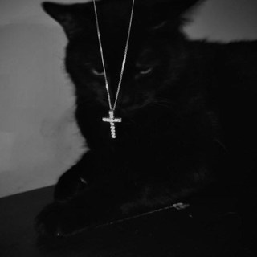

# MKW Music

**Свой музыкальный плеер в стиле Material You и «жидкого стекла»**
Волна под ваш вкус · жесты вместо касаний · работает как приложение

---

## ✨ Что умеет

| | |
|---|---|
| 🌊 **MKW Волна** | Музыка подстраивается под вас на лету, есть дизлайк |
| ✌️ **Жесты** | Следующий трек, лайк, дизлайк, пауза, не касаясь экрана. Камера работает только на вашем устройстве |
| 🔎 **Поиск** | iTunes, YouTube, Audius и поиск по ссылке; источник выбирается в Профиле |
| 🎙 **Шазам** | Узнать песню с микрофона или из файла |
| 🔗 **Поделиться** | Ссылка на трек, которую можно отправить другу |
| 🎤 **Страница артиста** | Топ треков и всё об исполнителе |
| 🎨 **Дизайн** | Светлая и тёмная темы, розовый акцент, стеклянное меню, которое идёт за пальцем |
| 📲 **Приложение** | Устанавливается на телефон и компьютер как обычное |

## 🚀 Как начать

1. Откройте сайт: **[18естьполина.рф](https://xn--18-8kctprpfitl4j.xn--p1ai)**
2. Зарегистрируйтесь по нику и паролю
3. Нажмите «Установить приложение»: так удобнее

## 🛠 Технологии

HTML · CSS · ES-модули (без сборки) · Firebase Auth и Firestore · YouTube IFrame API · iTunes Search · Audius · MediaPipe · Cloudflare Workers

## 👤 Создатель

**MKW MiloKwel**, сделано с любовью и в одиночку 🐈‍⬛

Это учебный личный проект. Приложение не хранит музыку и не копирует чужие треки: используются официальные плееры и открытые превью.
